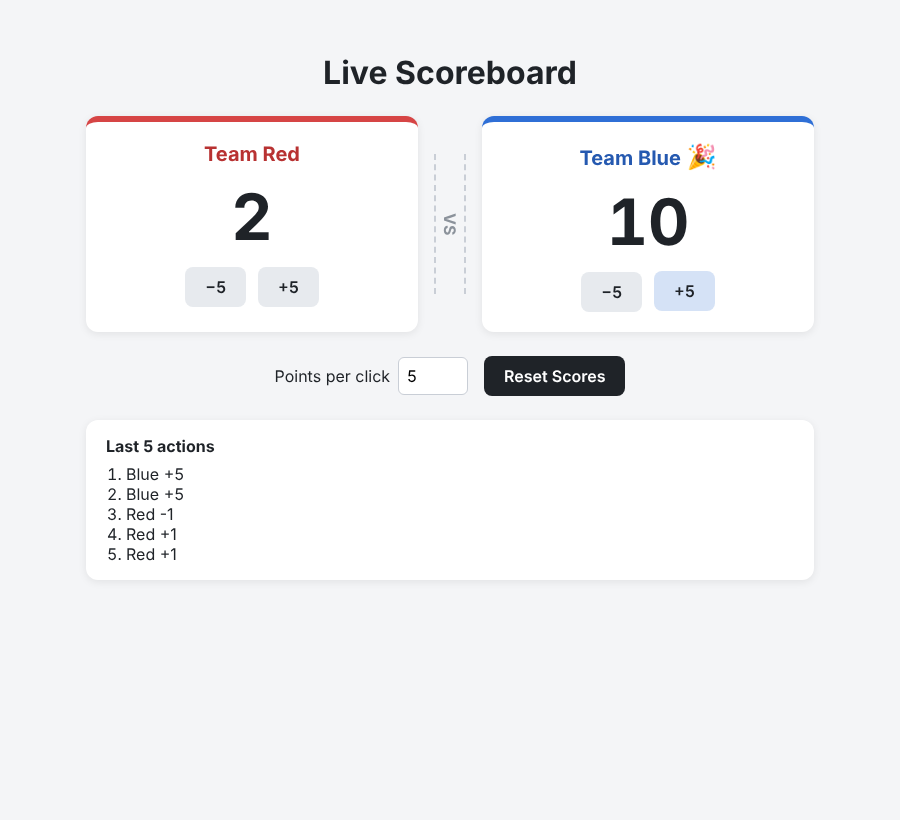

# react-scoreboard-bshara

A small React + Vite app that keeps score in a two-team game (**Team Red vs. Team Blue**).
Each team has **+1** and **−1** buttons. Scores update instantly and never drop below 0.



## Setup

```bash
npm install
npm run dev
```

Then open the URL Vite prints (usually http://localhost:5173).

Other scripts:

| Command           | What it does                      |
| ----------------- | --------------------------------- |
| `npm run build`   | Production build into `dist/`     |
| `npm run preview` | Serve the production build        |
| `npm run lint`    | Run ESLint (should print nothing) |

## File structure

```
src/
├── index.jsx       # Entry point, mounts <App />
├── App.jsx         # Root component, passes team names to <Scoreboard> (R-2)
├── Scoreboard.jsx  # Holds all state: redScore, blueScore, step, history, winner (R-3, R-6)
├── TeamPanel.jsx   # Stateless panel: name, score, +/− buttons via onAdd/onSubtract (R-4, R-5)
└── index.css       # Side-by-side layout and hover feedback (R-7)
```

## Requirements covered

- **R-1** `App.jsx`, `Scoreboard.jsx`, `TeamPanel.jsx`, `index.jsx` are all present.
- **R-2** `App` renders `<Scoreboard redName="Team Red" blueName="Team Blue" />`.
- **R-3** `Scoreboard` keeps `redScore` and `blueScore` as two separate `useState` values.
- **R-4** `TeamPanel` receives `score`, `onAdd` and `onSubtract` and renders the buttons and score.
- **R-5** The −1 button is `disabled` when that team's score is 0.
- **R-6** **Reset Scores** sets everything back to zero with functional updaters (`set…(() => 0)`). React batches them into a single re-render.
- **R-7** The panels sit side by side with a dashed "VS" divider. Buttons change colour and lift on hover.
- **R-8** `npm run build` and `npm run lint` finish with no warnings or errors.

## Stretch goals (all done)

1. **Custom step**: a "Points per click" number input. The buttons show the current step, e.g. `+5`.
2. **History log**: the last 5 actions, such as `Red +1` or `Blue -1`, newest first.
3. **Winner highlight**: the first team to reach 10 points gets a 🎉 next to its name. The winner stays set until reset.

## Tip

Open React DevTools, select `Scoreboard` and click the buttons to watch the state change live.
