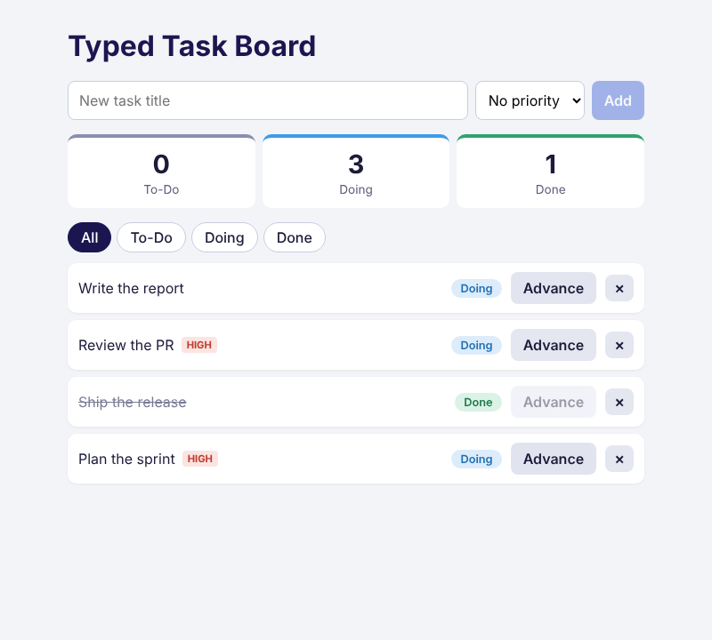

# typed-task-board-bshara

A small task board built with **React + TypeScript** in **strict mode**, with no `any` and no `as` casts.
You can add tasks, move each one from To-Do to Doing to Done, and remove tasks. A banner shows how many tasks are in each status.



## Setup

```bash
npm install
npm run dev
```

Then open the URL Vite prints (usually http://localhost:5173).

| Command             | What it does                                 |
| ------------------- | -------------------------------------------- |
| `npm run dev`       | Start the dev server                         |
| `npm run typecheck` | Run the TypeScript compiler (0 errors)       |
| `npm run lint`      | ESLint, including bans on `any`, `as` and `!` |
| `npm run build`     | Type-check, then build for production        |

## File structure

```
src/
├── types.ts                  # Status, Task, NewTask, StatusFilter, StatusCounts (R1, R2)
├── status.ts                 # getStatusInfo (switch + never), advanceTask, countByStatus, isTask guard (R6, R8)
├── hooks/useLocalStorage.ts  # Generic hook that saves typed state in localStorage
├── components/
│   ├── List.tsx              # Generic List<T> with renderItem and getKey (R5)
│   ├── TaskCard.tsx          # Typed props: task, onAdvance(id), onRemove(id) (R3)
│   ├── AddTaskForm.tsx       # Controlled form with typed ChangeEvent and FormEvent handlers (R4)
│   ├── SummaryBanner.tsx     # Counts per status, worked out from the tasks (R8)
│   └── FilterChips.tsx       # Typed filter buttons
├── App.tsx                   # Holds the task list and wires everything together
└── main.tsx                  # Entry point
```

## Requirements covered

| ID | How |
| -- | --- |
| R1 | `.tsx` project with a shared `types.ts`. `strict: true` is set in `tsconfig.app.json`, along with `noUncheckedIndexedAccess` and other extra checks. |
| R2 | `Status` and `Task` are used exactly as given and never widened to `string`. |
| R3 | `TaskCard` takes `TaskCardProps { task: Task; onAdvance: (id: number) => void; onRemove: (id: number) => void }`. |
| R4 | The input value lives in `useState`. The handlers are typed as `ChangeEvent<HTMLInputElement>` and `FormEvent<HTMLFormElement>`. The input clears after Add. |
| R5 | `List<T>` works with any item type: `T` is inferred from `items`, and `renderItem` and `getKey` receive that same `T`. |
| R6 | `getStatusInfo(status)` uses a `switch` to return the label and the next status (or `null` at Done). No casting. |
| R7 | No `any` anywhere. ESLint fails on `any`, on `as` assertions and on `!` non-null assertions. `tsc` reports 0 errors. |
| R8 | `countByStatus(tasks)` returns a `Record<Status, number>` that is recalculated on every render. Nothing is hard-coded. |

## Stretch goals (all done)

1. **Exhaustiveness check**: the `default` case of the status switch assigns the value to `never`. If you add `'blocked'` to `Status`, the build fails until you handle it.
2. **Utility types**: `NewTask = Omit<Task, 'id'>` is what the form creates. The app adds the id afterwards.
3. **Custom type guard**: `isTask(x): x is Task` checks the data loaded from localStorage before the app uses it.
4. **Generic hook**: `useLocalStorage<T>(key, initial, isValid)` keeps the task list after a page reload.
5. **Filter chips**: typed buttons for `StatusFilter = Status | 'all'`.

## Design notes

- **Types only where needed:** props, event handlers and state that starts empty (`useState<StatusFilter>('all')`) have explicit types. Everything else is inferred, for example `useState('')`.
- **Checks instead of casts:** values from a `<select>` or from localStorage are checked with type guards (`isStatus`, `isTask`) rather than cast with `as`.
